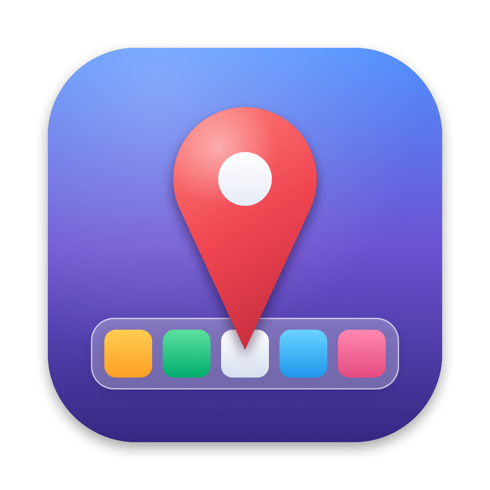

<p align="center"></p>

# DockPin

A free, lightweight macOS menu bar app that keeps the Dock on the displays you choose.

On multi-monitor setups, macOS moves the Dock to whichever screen you push the cursor against at the bottom edge. DockPin stops that: on displays where the Dock isn't allowed, it keeps the cursor a couple of points away from the Dock edge, so the Dock stays put.

## Features

- **Allow Dock on Display**: choose which monitors may show the Dock (remembered per monitor, even after unplugging)
- **Move Dock to Display**: send the Dock to any monitor from the menu
- **Auto-relocate**: after wake or a display change, moves the Dock back to your first allowed monitor
- Works with the Dock at the **bottom, left or right**
- Monitors stacked vertically stay reachable; only outer Dock edges are blocked
- **Launch at Login** toggle
- No ads, no purchases, no network access

## Requirements

- macOS 13 Ventura or later (Apple Silicon or Intel)
- Accessibility permission (needed to watch and adjust cursor movement)

## Download

Grab `DockPin-x.y.zip` from the [latest release](https://github.com/lwkoon/DockPin/releases/latest), unzip it and move **DockPin.app** to `/Applications`.

The app is not notarized by Apple, so macOS will block the first launch. Either right-click DockPin.app → **Open** → **Open**, or run:

```sh
xattr -dr com.apple.quarantine /Applications/DockPin.app
```

Then enable DockPin in **System Settings → Privacy & Security → Accessibility**.

## Build & install

Needs the Xcode Command Line Tools (`xcode-select --install`).

```sh
./build.sh            # builds build/DockPin.app (universal, ad-hoc signed)
./build.sh --install  # also copies it to /Applications and launches it
```

Then enable DockPin in **System Settings → Privacy & Security → Accessibility**. Until you do, the menu bar icon shows ⚠️.

> Each rebuild of an ad-hoc signed app looks like a new app to macOS. After rebuilding, turn DockPin off and on again in the Accessibility list (or run `tccutil reset Accessibility com.edonesolutions.dockpin` and grant it again).

To regenerate the app icon: `Icon/build_icns.sh`.

## How it works

A Core Graphics event tap watches mouse movement. When the cursor reaches the Dock edge of a display where the Dock isn't allowed, and there's no other display beyond that edge, DockPin moves the cursor 2 points back and zeroes the movement toward the edge. "Move Dock to Display" briefly pushes the cursor against the target display's Dock edge, then puts it back where it was.

## License

MIT
